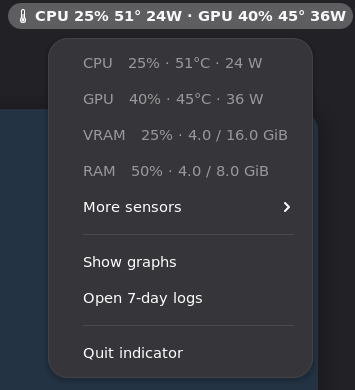
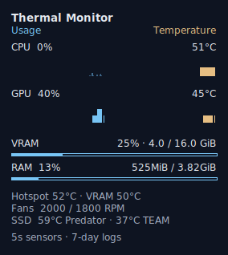

# Thermal Monitor

A compact Linux top-bar monitor for CPU/GPU load, temperatures, VRAM allocation
and RAM. A small Rust indicator provides the menu; optional Python integrations
record seven days of telemetry and feed a Conky desktop overlay.



*Native disposable-VM previews use simulated GPU readings.*

## What it shows

- CPU and GPU utilization and temperature in the top bar.
- CPU, GPU, VRAM allocation and RAM in the main menu.
- GPU hotspot, VRAM temperature, fan RPM and NVMe temperatures under **More sensors**.
- **Show graphs / Hide graphs**, **Open 7-day logs**, and **Quit indicator**.
- An optional desktop card with four graphs and VRAM/RAM capacity bars.



VRAM allocation means occupied capacity, not memory bandwidth. It is separate
from VRAM temperature. Unavailable or expired readings show `N/A`; a genuine zero
load or allocation remains zero. Quitting either display leaves the logger running.

## Start here

### Download and install

A [prebuilt Linux x86-64 release](https://github.com/delirious6423/thermal-monitor/releases/latest)
is available; Rust is not needed. The installer needs Python 3.10+ and systemd
user services. In a new empty directory, run it as your desktop user, without sudo:

```sh
curl -fLO https://github.com/delirious6423/thermal-monitor/releases/latest/download/install.py &&
curl -fLO https://github.com/delirious6423/thermal-monitor/releases/latest/download/SHA256SUMS &&
sha256sum --ignore-missing --check SHA256SUMS &&
python3 install.py
```

This installs the indicator and login entry for your user. It verifies the
downloaded binary package before changing files. Original files are backed up;
edited files are protected on subsequent updates/removal. Add `--with-logger`
and/or `--with-overlay` for the optional integrations; missing dependencies are
reported before installation. The root GPU reader is always a separate manual
setup. See [setup, updates and removal](docs/SETUP.md).

### Build from source

Requires Linux, Rust **1.99 or newer**, and a desktop with StatusNotifierItem support.
GNOME needs an AppIndicator extension. Numeric panel labels use `XAyatanaLabel`;
other tray hosts may display only the icon. No GTK or Python runtime is required
by the Rust executable.

```sh
git clone https://github.com/delirious6423/thermal-monitor.git
cd thermal-monitor
cargo build --release --locked
./target/release/thermal-monitor --once  # JSON; no tray or settings changes
./target/release/thermal-monitor         # Run in your desktop session
```

CPU/RAM readings work without the optional integrations. GPU load and allocation
need the collector; GPU temperatures currently need the separate snapshot bridge.
CPU utilization needs two samples, so it is unavailable on a one-shot read.

See **[Setup and removal](docs/SETUP.md)** for user services, login startup, logging,
the overlay, and the optional privileged GPU bridge. Existing installations can
use the reversible installers in `scripts/`.

## Scope and compatibility

This is an early, hardware-specific project tested on Ubuntu 26.04 / GNOME 50
with an Intel CPU, HP fan sensors, NVMe storage and an NVIDIA RTX 4090 Laptop GPU.
It is not a replacement for firmware thermal protection or a fan controller.

- The Rust sampler recognizes `coretemp` and `k10temp`; fan readings currently
  target the `hp` hwmon interface. Other hardware may need an adapter.
- The optional Conky feeder currently targets `coretemp`, HP fans and two SSD
  labels from the tested machine. Review its sensor mapping on other machines.
- GPU index **0** is displayed. There is no GPU selection or multi-GPU menu yet.
- Hotspot/VRAM temperatures come from experimental, undocumented registers.
  Their physical accuracy was not independently validated by this project.
- The Conky overlay uses X11/Xwayland. It was rendered and tested under Sway;
  the nested GNOME VM's software Xwayland initialization failed. Native GNOME
  menu rendering was tested separately.
- The included service examples use systemd; the collector expects Ubuntu's
  `/usr/libexec/sysstat/sadc` path and a working NVIDIA driver/`nvidia-smi`.

## Data and privileges

The Rust app reads `/proc`, hwmon, an existing GPU JSON snapshot and the bounded
tail of a local GPU log. It runs as your user and never opens `/dev/mem`, changes
power/fan settings, opens a network listener or uploads telemetry.

The optional root bridge runs a separately built GPU reader with device-memory
access; its privileges are separate from the indicator and logger. It is not
installed or enabled by the user-level installers. Logs stay under
`~/.local/state/thermal-monitor`, retaining seven calendar days including today.
They contain timestamps, hardware metadata, boot IDs and sensor readings.

See [sensor formats and freshness](docs/SENSORS.md) and
[tests and measurements](docs/TESTING.md). The earlier GNU-build app-only VM median RSS was
5.15 MiB; this excludes GNOME, the collector and Conky and is not a battery claim.

## Development

```sh
cargo fmt --all --check
cargo clippy --all-targets --all-features -- -D warnings
cargo test --locked --all-features
cargo test --locked --doc
cargo deny check
cargo machete
python3 tests/vm/check-desktop.py
```

The code uses safe Rust 2024, `zbus` for StatusNotifierItem/DBusMenu, and an
embedded thermometer icon. No privileged Rust daemon is needed. The collector
and overlay feeder remain separate Python programs.

Contributions: [CONTRIBUTING.md](CONTRIBUTING.md).
Changes: [CHANGELOG.md](CHANGELOG.md).
Privacy: [PRIVACY.md](docs/PRIVACY.md).
Release build and checks: [RELEASING.md](docs/RELEASING.md).

Licensed under [Apache-2.0](LICENSE). Conky, sysstat, NVIDIA tooling, GNOME and
[gputemps](https://github.com/ThomasBaruzier/gddr6-core-junction-vram-temps)
are separate projects with their own licenses. The GPU reader is not vendored.
